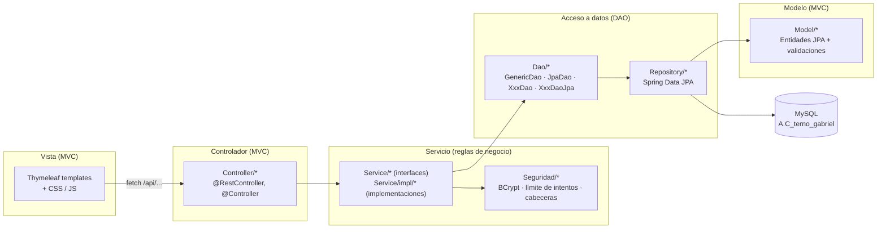
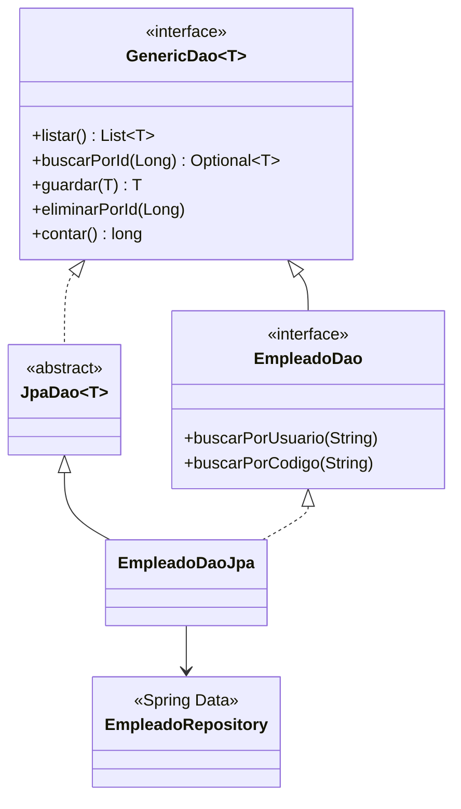
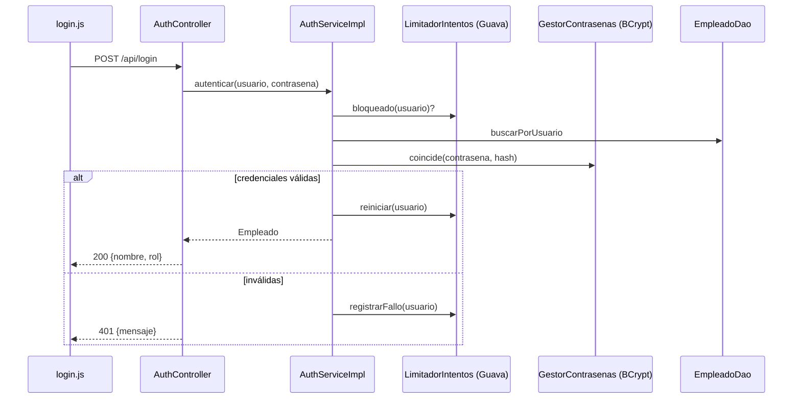

# Arquitectura – Terno Gabriel

Sistema de ventas, alquileres y confección de ternos (Spring Boot 4 · Java 21 · Thymeleaf · MySQL).

## 1. Capas (MVC + Service + DAO)

| Capa | Paquete | Responsabilidad |
|------|---------|-----------------|
| Vista | `resources/templates`, `static/css`, `static/js` | Pantallas (no se modificó el diseño) |
| Controlador | `Controller` | Recibe la petición HTTP, valida con `@Valid` y delega; no contiene reglas de negocio |
| Servicio | `Service`, `Service/impl` | Reglas de negocio, transacciones y registro (logs) |
| Seguridad | `Seguridad` | Cifrado BCrypt, límite de intentos, cabeceras HTTP |
| DAO | `Dao` | Contrato de acceso a datos y su implementación JPA |
| Modelo | `Model` | Entidades y validaciones (Jakarta Validation) |

## 2. Principios SOLID aplicados

| Principio | Dónde se ve |
|-----------|-------------|
| **S**ingle Responsibility | `GestorContrasenas` solo maneja contraseñas; `LimitadorIntentos` solo cuenta intentos; `ReporteExcelServiceImpl` solo exporta; los controladores solo traducen HTTP |
| **O**pen/Closed | Nuevos informes o nuevas entidades se agregan con clases nuevas (otro `XxxDao`, otro `Service`) sin modificar las existentes |
| **L**iskov | Cualquier `XxxDaoJpa` puede sustituir a su interfaz `XxxDao`/`GenericDao<T>` (y a un `mock` en las pruebas) |
| **I**nterface Segregation | Interfaces pequeñas por caso de uso (`AuthService`, `PrendaService`, `ReporteService`...) en lugar de una interfaz gigante |
| **D**ependency Inversion | Los servicios dependen de interfaces `Dao`, no de JPA; los controladores dependen de interfaces `Service`. Inyección por constructor |

## 3. Patrón DAO

Hay un DAO por entidad: Empleado, Cliente, Prenda, Boleta, Confeccion, Penalidad, Calificacion y Configuracion.

## 4. Flujo de una petición (inicio de sesión)

## 5. Seguridad

- Contraseñas con **BCrypt** (`spring-security-crypto`); las contraseñas antiguas en texto plano se cifran al arrancar o en el primer ingreso. La contraseña **nunca** viaja de vuelta en el JSON (`@JsonProperty(access = WRITE_ONLY)`).
- **Límite de intentos** de inicio de sesión (5 fallos → bloqueo de 5 minutos, respuesta HTTP 429), con una caché de Guava.
- **Credenciales fuera del repositorio**: `application-local.properties` está en `.gitignore`; se admiten variables `DB_HOST`, `DB_USERNAME`, `DB_PASSWORD`.
- **Validación** de entradas con Jakarta Validation (entidades) y `Preconditions` de Guava (reglas de negocio).
- **Cabeceras HTTP** de seguridad (`X-Content-Type-Options`, `X-Frame-Options`, `Referrer-Policy`, `Cache-Control: no-store` en `/api`).
- **Errores sin detalles internos** (`server.error.include-*=never`) y mensajes controlados desde `ErrorHandler`.
- **Neutralización de fórmulas** (CSV/Excel injection) al exportar informes.
- **Log forging** evitado: los datos del usuario se limpian antes de registrarse; nunca se registran contraseñas.
- Consultas con Spring Data/JPA (parámetros enlazados): sin concatenación de SQL con datos del usuario.

## 6. Librerías de apoyo

| Librería | Uso en el proyecto |
|----------|--------------------|
| **Google Guava** | `Preconditions` (validaciones), `ImmutableList` (catálogos fijos), `Ints`/`Doubles.tryParse`, `CacheBuilder` (`LimitadorIntentos`) |
| **Apache POI** | `ReporteExcelServiceImpl`: informes `.xlsx` (botón *Exportar Excel*, `GET /api/reportes/excel`) |
| **Apache Commons Lang** | `StringUtils` en los servicios (recortes, vacíos, abreviado, limpieza para logs) |
| **Logback** | `logback-spring.xml`: consola + archivo rotativo `logs/terno-gabriel.log` (10 MB, 30 días); `LOG` en servicios |

## 7. Pruebas (TDD)

Pruebas unitarias con JUnit 5, Mockito y AssertJ (sin base de datos, los DAO se simulan):

`mvn test`

| Clase de prueba | Qué verifica |
|-----------------|--------------|
| `GestorContrasenasTest` | Cifrado BCrypt, sal distinta, migración de claves antiguas, clave temporal |
| `LimitadorIntentosTest` | Bloqueo tras N fallos, reinicio, independencia entre usuarios |
| `AuthServiceImplTest` | Login correcto/incorrecto, suspendido, bloqueo, cifrado al primer ingreso |
| `EmpleadoServiceImplTest` | Código correlativo, usuario repetido, restablecer contraseña |
| `ClienteServiceImplTest` | Promedio de calificaciones, rangos inválidos, DNI repetido |
| `PrendaServiceImplTest` | Código correlativo, categorías, cambios de estado permitidos |
| `BoletaServiceImplTest` | Venta/alquiler, fechas, bloqueo de cliente, anulación y devolución |
| `ReporteExcelServiceImplTest` | Contenido del Excel, filtros por fecha, neutralización de fórmulas |

Ciclo de trabajo: *rojo* (escribir la prueba que falla) → *verde* (implementar lo mínimo) → *refactor*.

## 8. Documentación del código (Javadoc)

`mvn javadoc:javadoc` genera la documentación en `target/reports/apidocs/index.html`.
